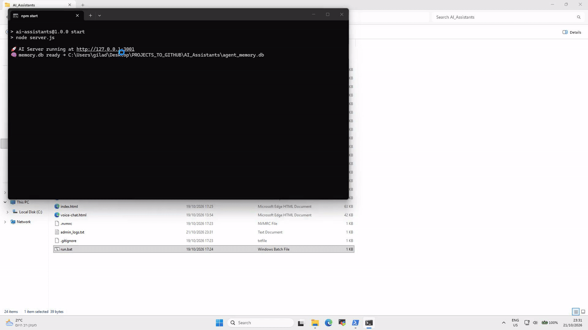
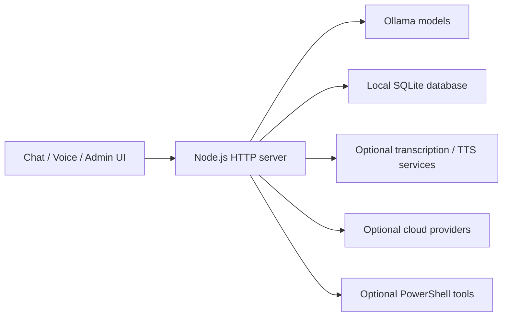

# AI Assistants

A local-first AI assistant that brings text chat, image and screen analysis,
voice conversations, and configurable tools into one English/Hebrew interface.
An administration dashboard manages model endpoints, API keys, services, and tools.

The application uses a plain JavaScript frontend, a Node.js HTTP server, and
SQLite for persistent conversation history. Text chat runs against a local
Ollama model without a paid API key. Voice servers and cloud providers are optional.



## Features

- Text chat with Ollama, model selection, and persistent conversation history.
- Image uploads and screen snapshots for vision-capable models.
- Interactive voice chat with voice activity detection and speech playback.
- Configurable PowerShell tools exposed to supported model tool calls.
- Admin dashboard for service checks, configuration, tools, and logs.
- English by default, with a persistent HE / EN toggle and RTL/LTR layouts.

## Quick start

### Requirements

- **Node.js 22 or newer** and npm. Node.js 24 is the recommended project runtime
  and is recorded in `.nvmrc`.
- **Ollama**, installed and running on the same machine or a reachable server.
- A downloaded model. The default is `gemma3:4b`, which supports text and images.
  See the [Ollama model page](https://ollama.com/library/gemma3) for available sizes.
- Internet access for the initial install, model download, and the frontend's CDN
  assets. This project is not packaged as a fully offline application.

Install Ollama using its [official instructions](https://docs.ollama.com/quickstart).
Then download the default model:

```sh
ollama pull gemma3:4b
```

If Ollama is not already running, start it with `ollama serve` in a separate
terminal. Do not start a second instance if the desktop application already runs it.

After cloning the repository, open a terminal in the directory containing
`package.json` and run:

```sh
npm ci
npm run setup
npm start
```

Open **http://127.0.0.1:3001**. The admin dashboard is at
**http://127.0.0.1:3001/admin**.

`npm run setup` creates local configuration files from the examples and never
overwrites existing files. The SQLite database is created automatically.
On Windows, `run.bat` can also start an already installed project.

### First walkthrough

1. Open **Admin → Services** and check that Ollama is reachable.
2. Return to chat and send a text message. The server uses the configured default
   model unless you explicitly select a model in the UI.
3. Open **Model** to inspect the models installed in Ollama and choose text/image
   models. The selection is saved in this browser.
4. Upload an image or select **Share screen → Capture and ask** with a vision model.
5. Switch **HE / EN** and open **History** to inspect saved conversations.

No TTS server, transcription server, cloud key, or PowerShell tool is required for
the initial text/image walkthrough. Leave optional services unconfigured until
you want to try those features.

## Configuration

Edit the generated `admin_config.json`, or use **Admin → API settings**.
Keep machine-specific URLs and API keys in this local file, not in JavaScript.

| Setting | Default | Purpose |
| --- | --- | --- |
| `OLLAMA_HOST` | `http://localhost:11434` | Ollama API base URL |
| `DEFAULT_MODEL` | `gemma3:4b` | Exact model tag installed in Ollama |
| `TTS_HOST` | `http://localhost:5002` | Optional Coqui-compatible speech server |
| `WHISPER_HOST` | `http://localhost:9000` | Optional transcription server base URL |
| `OPENAI_KEY` | Empty | Optional OpenAI speech API key |
| `XAI_API_KEY` | Empty | Optional xAI chat API key |
| `ELEVENLABS_API_KEY` | Empty | Optional ElevenLabs speech API key |
| `LISTEN_HOST` | `127.0.0.1` | Interface on which this application listens |
| `PORT` | `3001` | Application HTTP port; restart after changing |
| `MAX_BODY_MB` | `10` | Maximum incoming JSON request size in megabytes |

For example, if Ollama runs on a different computer, change only `OLLAMA_HOST`
to that computer's reachable address. `localhost` always means the computer
running this Node.js server.

Configuration precedence is **local JSON → environment variable → default**.
Environment variables are optional; `OPENAI_KEY` corresponds to
`OPENAI_API_KEY` in the environment. Other names match the table.
The app does not automatically load `.env` files.

Most settings are read for each request. Restart after changing `PORT`,
`LISTEN_HOST`, or environment variables. A model selected in the browser takes
precedence over `DEFAULT_MODEL`; change the selection if the browser still uses
an old model. Screen snapshots use the selected image model, then the selected
text model, then a previously saved screen-model override, then the server default.

The default binding is local-only. If you intentionally need LAN access, set
`LISTEN_HOST` to `0.0.0.0` in the JSON file and restart. The admin API has no
authentication, and enabled tools execute code with the server user's permissions:
use this only on a trusted machine/network. Do not expose it directly to the internet.
Private configuration files and databases are not served as static web assets.

## Optional voice features

Text chat works independently of voice services. There are separate voice paths:

| Feature | Additional requirement |
| --- | --- |
| Microphone button in text chat | Browser speech-recognition support and microphone permission |
| Browser speech playback | Available system/browser voices; select **Windows** in TTS settings |
| Interactive voice chat | A compatible transcription service; browser speech playback can provide audio output |
| Coqui playback | A compatible TTS service at `TTS_HOST` |
| Continuous voice during screen sharing | Both transcription and Coqui-compatible TTS services |
| Cloud speech/chat | A key for the corresponding provider |

Transcription and TTS servers are **not included** in this repository. The server
expects these HTTP contracts:

- Transcription: `POST /transcribe` with multipart `audio_file` and optional
  `language`; response JSON: `{ "text": "recognized speech" }`.
- Local TTS: `GET /api/tts?text=...`; response: audio bytes, normally WAV.

A Whisper implementation with a different API needs an adapter. Merely installing
the Whisper Python library does not provide the HTTP service this application uses.
Voice availability and browser speech recognition vary by browser and platform.
Use a supported browser on localhost and grant microphone/screen permissions when prompted.

## Optional tools

The initial tool list is empty. Open **Admin → Tools** to create a tool or add
the included UI example. Tools live in the ignored `admin_tools.json` file, so
personal scripts and file paths are not part of a fresh checkout.

Tool execution uses Windows PowerShell on Windows and `pwsh` on macOS/Linux.
Install PowerShell separately on platforms where it is unavailable. Individual
tool scripts may still depend on Windows-specific commands. A model must support
the tool-calling format to use tools successfully.

## Architecture



| File | Responsibility |
| --- | --- |
| `server.js` | HTTP routes, service integrations, configuration, tool execution |
| `memory.js` | SQLite memory and conversation persistence |
| `index.html` | Text chat, model/TTS settings, history, screen capture |
| `voice-chat.html` | Voice activity detection and interactive voice UI |
| `admin.html` | Configuration, service status, and tool management |
| `i18n.js`, `i18n.css` | Translation dictionaries, language preference, direction-aware layout |
| `scripts/setup.js` | Non-destructive first-run configuration setup |

See [UI_LANGUAGE.md](UI_LANGUAGE.md) for translation maintenance.

## Checks and troubleshooting

```sh
npm run check
```

This command checks JavaScript syntax; it does not exercise external AI or audio
services. There is currently no automated end-to-end test suite in the repository.

- **Cannot find `sqlite3`:** run `npm ci` in this project directory. Dependencies
  must be installed here, not inherited from a parent folder.
- **SQLite installation fails:** the native package uses prebuilt binaries where
  available. Other platforms may need local build tools; see
  [node-sqlite3 installation](https://github.com/TryGhost/node-sqlite3#installation).
- **Ollama is unavailable:** check `OLLAMA_HOST`, confirm Ollama is running, and
  retry the service check. `ollama list` shows models on the local Ollama installation.
- **Model not found:** pull the exact tag in `DEFAULT_MODEL` or select an installed
  model. The UI does not download models automatically.
- **Image analysis fails:** select a vision-capable model. Text-only models can
  still be used for ordinary chat.
- **Port already in use:** stop the other server or change `PORT` in the JSON file.
- **Invalid configuration:** correct JSON syntax and use valid HTTP(S) service URLs,
  a port from 1 to 65535, and a positive request-size limit.
- **Voice service offline:** text chat still works. Configure the optional service
  matching the HTTP contracts above before testing that voice path.

## Files to keep local

`.gitignore` excludes `admin_config.json`, `admin_tools.json`, `admin_logs.txt`,
SQLite database files, `.env` files, and `node_modules`. Commit the example JSON
files, `package.json`, and `package-lock.json` instead. Existing files remain on
your computer; setup does not delete or replace them.

Review the staged files before publishing. Git ignore rules do not remove files
that were already committed. Add your own screenshots or demo recording only
after checking that they do not show private conversations, keys, or local paths.
